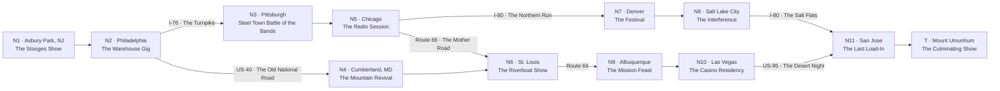

# Highway Magic — A Variant Campaign

A 1976 cross-country rock tour from the East Coast to Mount Umunhum. Teenagers in a band, concerts in strange towns, running into the same weird people over and over, and a slow argument about the future of America encoded as axes.

This document shows how the Overworld MVP rules apply to a very different setting from a dungeon crawl: looser, episodic, road-movie-shaped. Same objects, same ritual, same socket.

---

## Setting & Tone

Summer 1976, the Bicentennial. The party is a high school band driving a converted school bus west, gig to gig, trying to make it to the biggest show of their lives on the California coast. Scooby-Doo mystery machine energy: every town has a venue, a local weirdness, and a small problem the band gets tangled in.

The campaign opens in the parking lot of a real Iggy Pop and the Stooges show on the East Coast and ends with a culminating ritual — or broadcast, or concert, depending on how things go — atop **Mount Umunhum**, the decommissioned Air Force radar station in the hills south of San Francisco, wrapped in local ghost stories.

The background argument of the whole campaign: **what is America becoming?** Iggy Pop stands (surprisingly) for Technology — electricity, amplification, speed, the raw power of the machine. Carl Sagan stands (surprisingly) for Magic — the cosmos as mystery, wonder, the sacred. Neither appears in play more than glancingly; they are the two prophets whose argument the band is unknowingly settling.

---

## Axes

**Magic** (start 3) — ley lines waking up, rituals that work, the mountain's ghosts growing restless. High Magic: the mystical America is real and rising.

**Technology** (start 6) — radar stations, radio towers, surveillance vans, the interstate itself. High Technology: the machine America consolidates.

*Magic and Technology are declared an **opposed pair** on this map: most impacts that raise one lower the other, printed explicitly per the monopolar rules.*

**Fame** (start 2) — the band's legend. Radio play, packed shows, word traveling ahead of the bus. Several edges and goal cards key off it; it is also the fuel for the final show.

**Heat** (start 1) — attention from the wrong people: government agents, highway patrol, the cult. High Heat closes doors and opens uglier ones.

---

## Recurring Elements

The connective tissue of the road. Each is written into multiple node premises and *changes state* based on printed question outcomes — the DAG's answer to a persistent NPC.

- **The Cosmic Bus** — a school bus of friendly hippies heading west, encountered in the opening parking lot. In the Midwest they've picked up robes and a leader. By the desert they are the **Death Witch Cult**, and they remember exactly how the band treated them in Philadelphia.
- **The Iron Serpents MC** — a motorcycle gang running the same route. Dangerous, honorable, useful. Never villains unless made into them.
- **The Agents** — two men in a sedan that is always three cars back. Whose agency? Depends which axis is winning.

---

## The Map

Nodes are cities; edges are highways. Northern route = college towns, radio, infrastructure (Technology-flavored). Southern route = desert, missions, old places (Magic-flavored). The party chooses their America.

---

## Sample Nodes

### N1 · Asbury Park, NJ — *The Stooges Show* (start)

Premise: The band's beat-up bus is parked between the Cosmic Bus and a row of Iron Serpent choppers outside an Iggy Pop and the Stooges show. Tonight they're nobody. Somewhere in this parking lot is the reason they go west.

- Q1 *Did the band play the impromptu parking-lot set?* — yes: Fame +1 · no: (no impact)
- Q2 *Did they part on good terms with the Cosmic Bus?* — yes: Magic +1 · no: Heat +1
- Q3 *Did they earn the Iron Serpents' respect?* — yes: (no impact — it's a key) · no: (no impact)

**Edges out:**

| To | Name / flavor | Requires | Impacts |
|---|---|---|---|
| N2 | **The Serpent Escort** — riding west inside a wall of chrome | Q3 = yes | Heat −1, Technology +1, Magic −1 |
| N2 | **The Turnpike Alone** — first light, toll booths, coffee | — | — |

### N4 · Cumberland, MD — *The Mountain Revival*

Premise: A tent revival wants a band; the local AM station wants to broadcast it. The preacher's daughter knows a song that isn't in any hymnal, and the hollow behind the tent hums at night.

- Q1 *Was the hidden song performed?* — yes: Magic +2, Technology −2, Heat +1 · no: (no impact)
- Q2 *Did the broadcast go out over the AM station?* — yes: Fame +2 · no: (no impact)

### N10 · Las Vegas — *The Casino Residency*

Premise: Three nights, good money, a casino manager who never blinks and a contract nobody read. The Death Witch Cult's bus is in the parking structure. They've been waiting.

- Q1 *Did the band finish the residency?* — yes: Fame +2, Technology +1, Magic −1 · no: Heat +1
- Q2 *Was the contract's fine print broken?* — yes: Heat +2 · no: (no impact)
- Q3 *Did anyone accept the Cult's invitation?* — yes: Magic +2, Technology −2, Heat +1 · no: (no impact)

---

## Terminal — Mount Umunhum, *The Culminating Show*

Premise: The radar cube on the summit, a generator, the band's gear, and everyone the road brought — Serpents, Agents, what's left of the Cosmic Bus. One show to settle the argument.

- Q1 *Did the show reach its audience?* — yes: Fame +2 · no: (no impact)
- Q2 *Was the old radar array switched on for the finale?* — yes: Technology +2, Magic −2 · no: (no impact)
- Q3 *Was the mountain's rite completed at midnight?* — yes: Magic +2, Technology −2 · no: (no impact)

**Endings (checked in order):**
- **Fame ≥ 6 and Magic ≥ 8:** *The ley lines light up the coast. The band's last chord is still audible in the hills, some nights.* — **Party win, mystical America.**
- **Fame ≥ 6 and Technology ≥ 8:** *The broadcast rides the old radar array to half the hemisphere. Rock and roll, electrified, forever.* — **Party win, machine America.**
- **Fame ≥ 6:** *A great show on a strange mountain. The argument goes unsettled — America stays weird.* — **Party win, ambiguous.**
- **Otherwise:** *They played to the Agents, two Serpents, and the wind.* — **Party loss.** Nobody came.

The party's real job across the map is **Fame ≥ 6** — get famous enough that the final show matters. *Which* victory it becomes is where the goal cards do their quiet work.

---

## Goal Cards

- *The Believer* — Magic ≥ 8 at end: **3 VP**
- *The Futurist* — Technology ≥ 8 at end: **3 VP**
- *The Star* — Fame ≥ 8 at end: **3 VP**
- *The Outlaw* — Heat ≥ 5 at end: **2 VP**, plus 1 VP if the party still won
- *The Clean One* — Heat never rose above 2 (per log): **2 VP**
- *Witch-Curious* — a Cult invitation was accepted, any node (per log): **2 VP**
- *Serpent Blood* — the party traversed two or more Serpent-related edges (per log): **2 VP**

---

## What This Variant Demonstrates

- **Convergent routes with flavor:** north and south paths reach the same coast but push opposite axes — the map itself is the Technology/Magic argument.
- **Recurring elements via questions:** the Cosmic Bus's slide into the Death Witch Cult is just node premises reading earlier answers off the log. No new machinery.
- **Multiple endings from one terminal:** the ending table on a single terminal node replaces multiple terminal nodes when the geography ends in one place.
- **A party goal that isn't a fight:** Fame ≥ 6 is a pure accumulation goal — the "boss" is whether anyone shows up.
- **The socket holds:** every question above is answerable by D&D, Axis, or pure improv. Nothing in this campaign cares how a scene resolves, only what became true.
